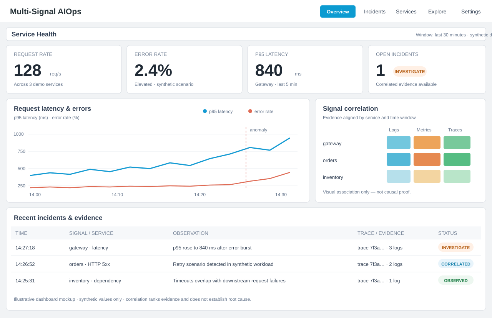

# Multi-Signal AIOps Platform for Microservices

An observability and AIOps project for collecting logs, metrics, and distributed traces from a synthetic microservices workload, detecting abnormal behavior, and correlating signals into evidence-backed incident views. Anomaly and correlation results support investigation; they are not claims of proven root cause.

## Overview

The project instruments a gateway → orders → inventory service chain with OpenTelemetry. The target architecture adds streaming processing, signal stores, a historical lakehouse, an incident API, and dashboards in incremental phases. Components marked as proposed below are architectural targets, not claims that the full platform is already deployed.

### Data Visualization

The dashboard below is an illustrative mockup using synthetic values to show the intended incident-investigation experience.

### Data Architecture

The diagram distinguishes the currently implemented telemetry foundation from the proposed target stack. The target architecture remains subject to the project's architecture decision and phase authorization.

