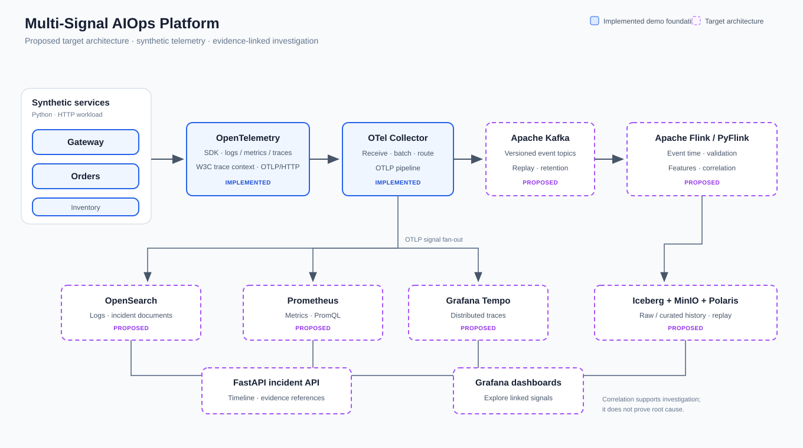

# Multi-Signal AIOps Platform for Microservices

An end-to-end observability and AIOps platform that ingests logs, metrics, and distributed traces from a microservices system, detects abnormal behavior in streaming data, correlates related signals, and helps engineers investigate incidents with traceable evidence.

> **Project status:** Phase 2 Kafka transport is implemented for the scoped Collector-to-Kafka slice. Unit/config checks and local Kafka produce/read-back smoke have passed; Architect review and Project Owner acceptance are pending. Phase 3 and later are not implemented.

## Why this project?

Modern microservices generate large volumes of telemetry across many services. During an incident, engineers often need to move between dashboards, logs, and traces to understand what changed and where to investigate. This project explores a unified pipeline that turns telemetry into actionable, evidence-backed incident views.

The system is designed to support investigation—not to claim that a model can determine the true root cause without validation. Anomaly detection identifies unusual signals; correlation and service ranking provide explainable leads for an engineer.

## Goals

- Instrument a reproducible microservices workload with OpenTelemetry.
- Ingest and process telemetry as streaming events, including event time and late data.
- Preserve raw and curated history for replay, analysis, and model experiments.
- Detect abnormal service behavior from metrics, logs, and traces.
- Correlate signals into incidents and rank potentially affected services with reasons.
- Link every alert to queryable evidence: metrics, log records, traces, and time ranges.
- Measure detection quality and pipeline behavior using controlled, labeled failure scenarios.
- Provide a reproducible local or Kubernetes deployment and clear operational documentation.

## Target architecture

```text
Instrumented microservices on Kubernetes
  └── OpenTelemetry SDK: logs, metrics, traces
        ↓
OpenTelemetry Collector: receive, filter, normalize, enrich metadata
        ↓
Kafka-compatible event broker (select one: Kafka or Redpanda)
        ↓
Apache Flink: event-time processing, windows, enrichment, correlation
  ├── MinIO / S3 + Apache Iceberg: raw and curated history, replay, analysis
  ├── OpenSearch: searchable logs and incident events
  ├── Prometheus-compatible metrics store: metrics queries
  └── Tempo: distributed traces
        ↓
Feature pipeline → anomaly detection → event correlation → service ranking
        ↓
Incident API, alerting, incident timeline, evidence links
        ↓
Grafana dashboards and (optional) grounded incident summaries
```



This is a target architecture; not every component is part of the local demo. Components can be brought up as needed. Use one product per responsibility—for example, do not run Kafka and Redpanda together or multiple competing trace stores without a demonstrated need. Exact versions and integrations should be validated together before deployment.

## Intended technology

| Concern | Intended technology | Purpose |
|---|---|---|
| Telemetry instrumentation | OpenTelemetry SDK | Emit correlated logs, metrics, and traces |
| Collection and transformation | OpenTelemetry Collector | Receive, filter, normalize, and enrich telemetry |
| Event transport | Apache Kafka 4.1.2 (Phase 2 local profile) | Buffer and distribute OTLP telemetry events |
| Stream processing | Apache Flink | Event-time windows, late events, enrichment, and correlation |
| Historical lake | MinIO/S3 + Apache Iceberg | Durable raw/curated data, replay, and analysis |
| Log and event search | OpenSearch | Search and investigate log/event records |
| Metrics | Prometheus-compatible store | Query service and pipeline metrics |
| Trace storage | Grafana Tempo | Inspect distributed traces |
| Detection experiments | Python and scikit-learn | Baselines and anomaly model comparison |
| Experiment/model tracking | MLflow | Track experiments and model versions |
| Visualization | Grafana | Service health and incident investigation |
| Runtime | Docker Compose initially; Kubernetes target | Reproducible local development and deployment |
| Delivery | CI pipeline; Helm/GitOps as an extension | Automated checks and repeatable rollout |

Exact versions, deployment profiles, and final backend selections will be recorded as implementation decisions when validated.

## Local demo

The demo provides a synthetic three-service HTTP request path (`gateway` → `orders` → `inventory`) and five labeled scenarios. Each run returns a `run_id`, scenario/fault metadata, and UTC scenario window; each JSONL event carries that same `run_id`. OpenTelemetry emits logs, metrics, and traces with W3C trace-context propagation over HTTP. An optional local Collector receives the signals and prints them through its debug exporter. The services listen on ephemeral localhost ports in one process; no broker, stream processor, or signal backend is included in the demo.

Install the pinned Python dependencies, start the Collector (host port published only on loopback), then run a scenario. The Collector's `debug` exporter prints logs, metrics, and traces; it is a diagnostic sink, not persistent storage. With `--events PATH`, the CLI writes JSONL events and a `PATH.run.json` manifest. The CLI refuses to write if either output already exists; pass `--force` to explicitly replace the event file and manifest:

```powershell
python -m pip install -r requirements.txt
docker compose -f collector/compose.yaml up -d
python -m demo.workload --scenario baseline --events output/baseline.jsonl
python -m demo.workload --scenario latency
python -m demo.workload --scenario http_5xx
python -m demo.workload --scenario timeout_retry
python -m demo.workload --scenario dependency_failure
python -m unittest discover -s tests -v
docker compose -f collector/compose.yaml logs --no-color otel-collector
docker compose -f collector/compose.yaml down
```

Use Python 3.10 or newer for the pinned OpenTelemetry dependencies. The direct SDK dependencies are pinned in `requirements.txt`. Scenario and local timing values are in `demo/workload.py` and `demo/config.json`; the event envelope is described in `demo/telemetry.schema.json`. Metric dimensions are bounded scenario/method/status values; run and trace IDs are not metric attributes. All payloads are synthetic.

### Optional Phase 2 Kafka transport

The opt-in `streaming` profile sends the Phase 1 OpenTelemetry logs, metrics, and traces from the Collector Contrib exporter to Apache Kafka. It does not change or publish the Phase 0 compatibility JSONL. Kafka and Collector host ports bind to loopback. The topics are `aiops.otlp.logs.v1`, `aiops.otlp.metrics.v1`, and `aiops.otlp.traces.v1`; payloads use OTLP Protobuf. Each topic uses one partition, replication factor one, and seven-day retention. See [`docs/PHASE_2_REPORT.md`](docs/PHASE_2_REPORT.md) for exact configuration, verification evidence, and limitations.

```powershell
uv venv .venv
uv pip install --python .venv\Scripts\python.exe -r requirements.txt
$compose = @("compose", "--profile", "streaming", "-f", "collector/streaming.compose.yaml")
docker @compose up -d kafka
docker @compose exec kafka /opt/kafka/bin/kafka-topics.sh --create --if-not-exists --topic aiops.otlp.logs.v1 --partitions 1 --replication-factor 1 --config retention.ms=604800000 --bootstrap-server broker:19092
docker @compose exec kafka /opt/kafka/bin/kafka-topics.sh --create --if-not-exists --topic aiops.otlp.metrics.v1 --partitions 1 --replication-factor 1 --config retention.ms=604800000 --bootstrap-server broker:19092
docker @compose exec kafka /opt/kafka/bin/kafka-topics.sh --create --if-not-exists --topic aiops.otlp.traces.v1 --partitions 1 --replication-factor 1 --config retention.ms=604800000 --bootstrap-server broker:19092
docker @compose up -d otel-collector
.\.venv\Scripts\python.exe -m demo.workload --scenario baseline
.\.venv\Scripts\python.exe -m unittest discover -s tests -v
foreach ($signal in @("logs", "metrics", "traces")) {
    docker @compose exec kafka /opt/kafka/bin/kafka-console-consumer.sh --bootstrap-server broker:19092 --topic "aiops.otlp.$signal.v1" --from-beginning --max-messages 1 --timeout-ms 15000
}
docker @compose stop
```

Retries use bounded backoff and an in-memory queue; prolonged outages or a full queue can result in dropped data, and retries can create duplicates. This single-broker local profile is not highly available. Consumers must be idempotent. Kafka receives the OTel signals, not the compatibility JSONL.

A read-only MCP adapter is a future optional direction after Phase 6 incident/timeline/evidence queries exist. It is not implemented and must not expose mutations or operational actions.

## Detection and incident investigation

The dashboard below is an illustrative mockup using synthetic values. It shows the intended investigation workflow; it is not a deployed dashboard or measured live telemetry.


The feature pipeline can aggregate signals by service and time window, such as request rate, error rate, p50/p95/p99 latency, error-log counts, failed spans, retries, and timeouts. Detection will compare a transparent statistical or rule-based baseline with a suitable unsupervised model, such as Isolation Forest. More complex sequence models are optional and should only be added when data and evaluation justify them.

An incident groups related anomalies by time and service dependency. A service ranking should explain its evidence—for example, anomaly start time, impact magnitude, affected dependencies, and supporting traces or logs. The ranking is an investigation aid, not an unverified claim of causal root-cause identification.

An optional language model may summarize retrieved incident evidence and suggest investigation questions. It must not invent telemetry or replace deterministic detection. Summaries should link to the underlying evidence and disclose uncertainty.

## Evaluation

Controlled failure scenarios provide ground truth, for example:

- Increased latency in one service.
- Elevated HTTP 5xx responses in a dependency.
- Timeout and retry amplification.
- A dependency slowdown or partial outage.

Report both data-platform and detection outcomes:

- Detection precision, recall, F1, false-positive rate, and time to alert.
- Service-ranking top-k accuracy for labeled scenarios.
- Event throughput and end-to-end processing latency (including p95 where applicable).
- Behavior with late, duplicate, malformed, or replayed events.
- Recovery behavior after a consumer or processor restart.
- Resource consumption under a documented test workload.

All reported performance numbers must come from a reproducible run and include the workload and environment. Do not present targets or estimates as measured results.

## Disclaimer

This is an engineering and research project. Its alerts and service rankings are decision support for incident investigation; they are not proof of causality or a substitute for operator judgment.
